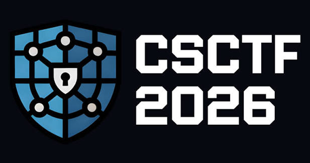

<p align="center">
  
</p>

<h1 align="center">CSCTF 2026 — Team Double Espresso</h1>

<p align="center">
  Full writeups for every challenge solved by <strong>Double Espresso</strong> at
  <a href="https://2026.chronos-security.ro/challenges">Chronos Security CSCTF 2026</a>.
  <br>
  Flag format: <code>CSCTF{...}</code>
</p>

<p align="center">
  
  
</p>

---

## 📖 About

This repository contains the full set of writeups our team produced while playing
**CSCTF 2026**, covering every challenge we solved end-to-end: the recon, the
vulnerability, the exploit/solve script, and the recovered flag — with screenshots
documenting the live solve where relevant.

All 64 challenges are written up in a single file: [`CSCTF2026_Double_Espresso_Writeups.md`](./CSCTF2026_Double_Espresso_Writeups.md).

## 🗂️ Breakdown by category

| Category | Challenges |
|---|---|
| Forensics | 22 |
| Crypto | 9 |
| Reverse Engineering | 8 |
| Misc | 7 |
| Network | 6 |
| Web | 5 |
| Pwn | 4 |
| Welcome | 1 |
| Mobile | 1 |
| Machine Learning | 1 |
| **Total** | **64** |

## 🧰 Tools referenced in the writeups

`curl` · `jq` · Python (`pwntools`, `websockets`, `hashlib`, `hmac`) · `sqlmap`-style manual SQLi ·
`binwalk` · `base64` · custom PNG/zlib carving scripts · ECDSA/nonce-reuse math · SHA-256 length
extension · MT19937 state recovery · and more — each technique is explained inline in its own
section.

## 📁 Repository structure

```
CSCTFWU2026/
├── README.md                              # this file
├── CSCTFLOGO.jpg                           # team / event logo
├── CSCTF2026_Double_Espresso_Writeups.md   # the full writeup (all 64 challenges)
└── images/                                 # screenshots referenced inline in the writeup
```

## 🙌 Team

Played and written up by **Double Espresso**.

## ⚠️ Disclaimer

All techniques described here were used exclusively against the sandboxed, intentionally
vulnerable infrastructure provided by Chronos Security for CSCTF 2026. Nothing in this
repository should be applied against systems you do not own or have explicit authorization
to test.
